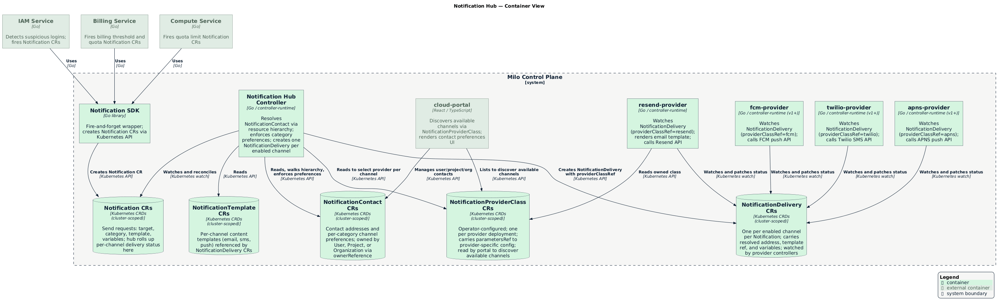

<!-- omit from toc -->
# Notification Hub

- [Summary](#summary)
- [Motivation](#motivation)
  - [Goals](#goals)
  - [Non-Goals](#non-goals)
- [Proposal](#proposal)
  - [How It Works](#how-it-works)
  - [Why not NATS, Vector, or a gateway](#why-not-nats-vector-or-a-gateway)
  - [User Stories](#user-stories)
  - [Key Capabilities](#key-capabilities)
  - [Notes / Constraints / Caveats](#notes--constraints--caveats)
  - [Risks and Mitigations](#risks-and-mitigations)
- [Design Details](#design-details)
  - [Resource Overview](#resource-overview)
  - [NotificationContact Resource](#notificationcontact-resource)
  - [Notification Resource](#notification-resource)
  - [NotificationTemplate Resource](#notificationtemplate-resource)
  - [Contact Resolution and Hierarchy](#contact-resolution-and-hierarchy)
  - [Category-Based Routing and Preference Enforcement](#category-based-routing-and-preference-enforcement)
  - [NotificationDelivery Resource](#notificationdelivery-resource)
  - [Provider Controller Pattern](#provider-controller-pattern)
  - [Notification SDK](#notification-sdk)
  - [Login Events and the Activity System](#login-events-and-the-activity-system)
  - [Portal Integration](#portal-integration)
  - [RBAC Boundaries](#rbac-boundaries)
  - [Observability](#observability)
- [Future Work](#future-work)
- [Implementation History](#implementation-history)
- [Drawbacks](#drawbacks)
- [Alternatives](#alternatives)
  - [Direct Provider Integration Per Service](#direct-provider-integration-per-service)
  - [User-Only Notification Targets](#user-only-notification-targets)
  - [Flat Contact Model Without Hierarchy](#flat-contact-model-without-hierarchy)
- [References](#references)

## Summary

The Notification Hub is a platform-owned routing layer that decouples platform
services from delivery channels, providers, and user preferences. Any service —
compute, billing, IAM — fires a `Notification` resource naming a target (user,
project, or organization), a category (e.g. `billing`, `security`), and a
template. The hub resolves the right contact by walking the resource hierarchy,
applies per-category channel preferences, and fans out to the appropriate
channel-specific CRDs. Provider controllers — standalone repos that watch those
CRDs — call external backends such as Resend or Twilio. Services never own
provider credentials, retry logic, templating, or delivery tracking.

Contact resolution follows the [GCP Essential Contacts][gcp-essential-contacts]
model: a `NotificationContact` can be set at the organization, project, or user
level. When a notification targets a project, the hub walks up — project contact
→ organization contact → platform default — with override semantics at each
level. This is how billing, quota, and incident notifications reach the right
team even when they are not tied to a specific logged-in user.

All notification resources — `Notification`, `NotificationContact`,
`NotificationTemplate`, and channel CRDs — are **cluster-scoped**. This is a
deliberate durability decision: notification records are audit-relevant and must
survive the deletion of the project or organization they relate to. If these
resources were namespace-scoped and co-located with their subjects, deleting a
project or organization would cascade-delete the entire notification history for
that subject. Cluster scope ensures records are retained independently of subject
lifecycle.

v0 ships email delivery only, using the existing Resend provider
controllers migrated to watch `NotificationDelivery`. The concrete first use
case is suspicious login notifications. SMS, push, in-app inbox, and additional channel
types are future work.

## Motivation

The platform already delivers email through a pluggable provider controller
pattern — Resend and Loops provider controllers backed by existing email CRDs.
However, this capability is not surfaced to other services through a shared,
opinionated interface. Each service that needs to notify a user must
understand which CRDs to create, which provider is configured, and how to
resolve who to notify for a given project or organization. None of that should
be a per-service concern.

At the same time, notifications that are not tied to individual users —
quota-limit warnings, billing threshold alerts, incident communications — have
no clean model today. Binding them to a user identity is the wrong design:
the relevant contact for a billing alert on a project is whoever the project
owner has designated as the billing contact, not the user who happened to trigger
a quota check. Without a hierarchy-aware contact model, services either
hard-code user IDs, skip notifications entirely, or build bespoke resolution
logic that diverges over time.

The immediate trigger for this enhancement is a concrete, well-scoped use case:
notifying users when a suspicious login is detected. Suspicious login
notifications are user-scoped, are in the `security` category (non-suppressible),
and require no hierarchy resolution — making them the right starting point for
validating the end-to-end architecture before tackling more complex org/project
targeting. Login event ingestion into the activity system is a prerequisite for
this and is tracked separately (see [Login Events and the Activity System](#login-events-and-the-activity-system)).

### Goals

- Provide a single, shared notification path that any platform service can adopt
  in five lines of Go without knowing about providers, channels, or preferences.
- Model contacts at the organization, project, and user level with
  hierarchy-aware resolution following the [GCP Essential Contacts][gcp-essential-contacts]
  pattern, so that billing, quota, and incident notifications reach the right
  team without being tied to a specific user.
- Enforce per-category channel preferences: each contact can configure which
  channels are active for each notification category. The `security` category is
  always delivered regardless of preference.
- Suppress delivery to opted-out channels and record the
  suppression in `Notification` status, so the record is durable even when
  delivery does not occur.
- Keep provider credentials, retry logic, and backend API details entirely inside
  provider controller repos. No service other than a provider controller ever
  holds provider credentials.
- Ship a concrete v0 use case — suspicious login notifications — to validate the
  end-to-end architecture before expanding channel types.

### Non-Goals

- **SMS, push (iOS/Android), and in-app inbox delivery in v0.** The architecture
  is designed to support these channels; they are explicitly deferred to v1+.
- **Real-time in-app delivery via WebSocket or SSE.** The in-app channel will
  initially be a persistent inbox model. Real-time push is future work.
- **Broadcast or marketing-blast notifications.** The hub routes per-target
  transactional notifications. Broadcast campaigns are a different product concern.
- **Admin-managed custom notification categories.** The category set is a fixed
  platform enum in v0. Self-serve category management is deferred.
- **Detecting suspicious logins.** Anomaly detection is out of scope for this
  enhancement. The hub assumes the caller has already determined a login is
  suspicious. Detection logic and event ingestion into the activity system are
  tracked as a sub-issue.
- **Notification analytics or delivery reporting beyond status conditions.**
  Aggregate delivery dashboards are not part of this enhancement.

## Proposal

The hub introduces three new core resources in the `notification.miloapis.com`
API group:

**`NotificationContact`** is cluster-scoped and represents a contact point at a
specific level of the resource hierarchy — user, project, or organization. It
carries channel addresses (email, phone, push device tokens) and per-category
channel preferences. A mandatory `spec.subjectRef` field associates the contact
with the resource it belongs to: a `User`, a `Project`, or an `Organization`.
All three subject types are cluster-scoped resources, so `NotificationContact`
is cluster-scoped to match.

**`Notification`** is the send request. A service creates a `Notification` CR
specifying a target (`UserRef`, `ProjectRef`, or `OrgRef`), a category, and a
`NotificationTemplate` reference with template variables. The hub controller
resolves the contact, enforces preferences, and creates one
`NotificationDelivery` per enabled channel. Services never interact with
channel-specific resources directly.

**`NotificationTemplate`** is a reusable template with per-channel content
blocks — email subject and body, SMS body, push title and body. A single
template covers all channels; provider controllers select the block matching the
channel they are delivering on.

**`NotificationDelivery`** is created by the hub — one per enabled channel per
`Notification`. It carries the resolved contact address for that channel, the
template reference, and the variables. Provider controllers watch
`NotificationDelivery` resources filtered by `spec.channel` and are responsible
for calling the external backend and updating delivery status. Adding a new
channel provider requires only a new controller repo — the hub never changes.

### How It Works

The following sequence describes the end-to-end flow from a service detecting a
suspicious login to an email landing in the user's inbox.

**1. Service sends a Notification.**

The IAM service detects a login from an unrecognized device. It uses the
notification SDK to create a cluster-scoped `Notification` resource:

```yaml
apiVersion: notification.miloapis.com/v1alpha1
kind: Notification
metadata:
  generateName: suspicious-login-
spec:
  target:
    userRef:
      name: jsmith
  category: security
  templateRef:
    name: suspicious-login-alert
  variables:
    device: "Chrome on macOS"
    location: "São Paulo, BR"
    time: "2026-06-03T14:22:00Z"
```

The SDK wraps this in a single `kubectl`-equivalent apply call. The IAM service
never references a provider, a channel, or a contact address.

**2. Hub controller resolves the NotificationContact.**

The hub controller watches all cluster-scoped `Notification` resources. On
observing the new resource, it determines the target type (`UserRef`) and lists
cluster-scoped `NotificationContact` resources filtered by
`spec.subjectRef.kind=User` and `spec.subjectRef.name=jsmith`. For a
`ProjectRef`, the hub checks for a project-level contact first, then walks up to
the organization-level contact if none is found. For a `UserRef`, the
user-level contact is authoritative; there is no hierarchy above a specific
user for user-scoped notifications.

```yaml
apiVersion: notification.miloapis.com/v1alpha1
kind: NotificationContact
metadata:
  name: jsmith
spec:
  subjectRef:
    kind: User
    name: jsmith
  email: "jane.smith@example.com"
  preferences:
    - category: billing
      channels: [email]
    - category: incidents
      channels: [email]
    - category: product-updates
      channels: []   # opted out
```

Since `security` is non-suppressible, the controller does not consult
preferences and proceeds with all configured channels that carry an address.

**3. Hub controller applies preference enforcement.**

For non-`security` categories, the admission webhook on `Notification` creation
evaluates the resolved contact's preferences against the requested category. If
the contact has no channel enabled for the requested category, the webhook sets
`status.phase: Suppressed` and records a condition explaining the suppression.
No channel-specific CRD is created. The `Notification` resource remains as a
durable record that a send was requested but suppressed.

For `security`, enforcement is bypassed.

**4. Hub controller creates a NotificationDelivery per channel.**

For each channel for which an address exists and delivery is not suppressed, the
hub creates a `NotificationDelivery` as a child of the `Notification`. It
embeds the resolved contact address so provider controllers never need to read
`NotificationContact` directly:

```yaml
apiVersion: notification.miloapis.com/v1alpha1
kind: NotificationDelivery
metadata:
  generateName: suspicious-login-email-
  ownerReferences:
    - apiVersion: notification.miloapis.com/v1alpha1
      kind: Notification
      name: suspicious-login-xk9p2
      controller: true
      blockOwnerDeletion: false
spec:
  channel: email
  resolvedAddress: "jane.smith@example.com"
  templateRef:
    name: suspicious-login-alert
  variables:
    device: "Chrome on macOS"
    location: "São Paulo, BR"
    time: "2026-06-03T14:22:00Z"
  category: security
  notificationRef:
    name: suspicious-login-xk9p2
```

**5. Provider controller delivers via the channel backend.**

The `resend-provider` controller watches `NotificationDelivery` resources where
`spec.channel == "email"`. It reads `spec.templateRef`, renders the email
template block, calls the Resend API with `spec.resolvedAddress`, and patches
status:

```yaml
status:
  phase: Delivered
  providerMessageId: "msg_3Kp9xAb"
  deliveredAt: "2026-06-03T14:22:04Z"
```

A future `twilio-provider` watches the same `NotificationDelivery` kind where
`spec.channel == "sms"`. No hub changes are required when it is deployed.

**6. Hub controller aggregates status.**

The hub controller watches its child `NotificationDelivery` resources and rolls
up their phases into `Notification` status:

```yaml
status:
  phase: Delivered
  resolvedContact:
    name: jsmith
  channels:
    - channel: email
      phase: Delivered
      ref:
        kind: NotificationDelivery
        name: suspicious-login-email-xk9p2
```

### Why not NATS, Vector, or a gateway

We considered routing the SDK through a Vector agent (for local disk durability,
consistent with the billing pipeline) and through NATS + CloudEvents (for
decoupling and fan-out). Both were rejected because notifications have a
fundamentally different problem profile from billing events:

- **Notifications are low-frequency and event-triggered** — suspicious logins,
  quota alerts, billing thresholds. They are not a high-throughput stream where
  etcd becomes a bottleneck.
- **The `Notification` CR is itself the durable audit record.** Adding NATS or
  Vector as an intermediate step means the durable record does not exist until a
  consumer processes the message — introducing a window where a notification can
  be silently lost if the consumer is down.
- **The SDK creating a CR gives synchronous confirmation.** The caller knows the
  notification exists in etcd before returning. An async transport trades this
  guarantee for throughput that notifications do not need.
- **Infrastructure cost without a matching problem.** A Vector DaemonSet or NATS
  JetStream cluster is justified when event rates make the Kubernetes API a
  bottleneck. At notification rates, the Kubernetes API backed by etcd is
  sufficient durability.

If notification volume ever reaches billing-event scale, the transport can be
changed without modifying the `NotificationDelivery` contract — provider
controllers and the hub are unaffected by how `Notification` CRs arrive.

<p align="center">
  
</p>

### User Stories

#### Story 1: User Receives a Suspicious Login Alert

As a platform user, I want to be notified immediately if my account is accessed
from an unrecognized device so that I can take action to secure my account.

*Experience:* The IAM service detects a login anomaly and fires a `Notification`
with `category: security` and `templateRef: suspicious-login-alert`. Within
seconds the user receives an email at the address on their `NotificationContact`.
Because `security` is non-suppressible, this delivery is not gated on the user's
channel preferences. The suspicious login detection and event ingestion work are
tracked as a sub-issue and are prerequisites for this use case going live.

#### Story 2: Project Owner Sets a Billing Contact

As a project owner, I want to designate a specific person as the billing contact
for my project so that billing threshold alerts reach them rather than all
project members.

*Experience:* The owner creates a cluster-scoped `NotificationContact` with
`spec.subjectRef.kind=Project`, `preferences: [{category: billing, channels: [email]}]`,
and the billing contact's email address. When the billing service fires a
`Notification` with
`target.projectRef` and `category: billing`, the hub resolves this project-level
contact and routes the alert to the designated person. No user-level contact is
involved.

#### Story 3: Organization Sets an Incident Escalation Contact

As a platform operator managing a customer organization, I want to configure a
single escalation contact at the organization level so that any incident
notification targeting a project in that organization reaches the NOC, unless
the project owner has configured an override.

*Experience:* The operator creates a cluster-scoped `NotificationContact` with
`spec.subjectRef.kind=Organization` and `preferences: [{category: incidents, channels: [email]}]`. When
any service fires an incident notification targeting a project inside that
organization that has no project-level `NotificationContact`, the hub walks up
to the organization and delivers to the NOC. A project owner who wants to route
incidents to a different address creates a project-level `NotificationContact`
that takes precedence.

#### Story 4: Service Team Sends a Notification Without Knowing the Provider

As a service team building a compute quota alerting feature, I want to notify
project owners when a quota is approaching its limit without building any
provider integration or knowing which email system is deployed.

*Experience:* The team creates a `NotificationTemplate` with the quota alert
content for the `email` channel and fires a `Notification` with
`target.projectRef` and `category: billing`. The hub resolves the contact,
enforces preferences, and routes to whichever provider controller is deployed.
The compute service never imports a provider SDK, never holds API credentials,
and never retries against an external API.

### Key Capabilities

#### Fire-and-Forget for Service Teams

Services create a `Notification` CR and observe its status. They never interact
with provider APIs, manage credentials, implement retry logic, or know which
channel the notification is delivered on. The hub owns all of that.

#### Hierarchy-Aware Contact Resolution

Following the [GCP Essential Contacts][gcp-essential-contacts] model, a
`NotificationContact` at the project level overrides the organization-level
contact for the same category. A contact at the organization level applies to
all projects in that organization that have not defined their own override.
Services targeting a project or organization get the right contact automatically
— they do not need to know the contact's identity at the call site.

#### Category-Based Preference Enforcement

Every `Notification` carries a category from a fixed enum: `security`,
`billing`, `incidents`, `account`, `product-updates`. Each `NotificationContact`
carries per-category channel preferences. The hub enforces these preferences
before creating any channel-specific CRDs. The `security` category is
non-suppressible: delivery always proceeds regardless of preferences.

Suppressed notifications are recorded with `status.phase: Suppressed` and a
condition explaining which category and channel combination was suppressed. The
record is durable — the notification was requested, and the suppression is
auditable.

#### Provider-Pluggable Delivery

Each delivery backend is a standalone controller repo that watches channel-specific
CRDs and calls a backend API. Adding a new email provider requires a new repo
and kustomization — no changes to the hub or its CRD schemas. Adding a new
channel type (SMS, push) requires new channel CRDs and a corresponding provider
controller, not changes to `Notification` or `NotificationTemplate`.

#### Cascading Ownership

Channel-specific CRDs created by the hub carry `ownerReferences` pointing to
their parent `Notification`. Deleting a `Notification` cascades deletion to all
child channel resources, giving provider controllers the opportunity to cancel
in-flight deliveries via finalizers.

### Notes / Constraints / Caveats

#### Fixed Category Enum in v0

The category set — `security`, `billing`, `incidents`, `account`,
`product-updates` — is a fixed enum on the `Notification` CRD in v0. Services
cannot define custom categories. The enum is chosen to cover the observable
universe of notification types needed in v0 and v1 milestones. Custom categories
are explicitly deferred.

#### `security` Is Non-Suppressible by Design

A user who opts out of all channels still receives `security` notifications.
This is not a bug — users must be reachable for account security events
regardless of their preferences. The admission webhook skips preference
enforcement for `security` and logs this bypass in the `Notification` status
condition for auditability.

#### Email-Only in v0

v0 ships with email delivery only. `NotificationTemplate` already supports
per-channel content blocks for `email`, `sms`, and `push`. A template that
omits a channel block will cause the hub to skip that channel when it becomes
supported — this is not an error.

#### Contact Addresses Are Not Validated Against Identity

The email address stored on `NotificationContact` is not required to match a
verified identity in the IAM system. Contacts targeting external stakeholders
(e.g. a vendor's NOC pager address) are intentional. Validation that the address
belongs to a platform user is a future enhancement if needed.

#### One NotificationContact Per Subject in v0

In v0, the hub resolves a single `NotificationContact` per subject (one per
`User`, `Project`, or `Organization`). Multiple contacts per subject with
different category assignments are a v1+ capability.

### Risks and Mitigations

| Risk | Mitigation |
|------|------------|
| Contact not found at any hierarchy level | Hub sets `status.phase: Failed` with reason `ContactNotResolved`. The notification is a durable record; an operator can create the missing contact and re-trigger by patching `spec.retryAfter`. Alert fires on `notification_resolution_failures_total > 0`. |
| Preference enforcement races with contact updates | Preferences are evaluated at webhook admission time and again by the hub controller during fan-out. If they diverge (e.g. contact updated mid-flight), the controller's view wins. The admission webhook result is advisory for fast rejection, not authoritative. |
| `security` bypass creates a channel for audit-logging | Every bypass of preference enforcement for the `security` category is recorded in `Notification.status.conditions` with `reason: SecurityCategoryNonSuppressible`. This creates a per-notification audit trail without requiring a separate system. |
| Provider controller outage silently halts delivery | `NotificationDelivery` exposes `status.phase` and conditions. The hub aggregates these into `Notification.status.channels[*].phase`. Alert fires on `notification_delivery_failures_total` by channel. |
| Template renders with missing variables | The hub validates that all variable keys declared in `NotificationTemplate.spec.requiredVariables` are present in `Notification.spec.variables` at admission time. Missing variables are a hard rejection — `status.phase: Failed` with `reason: TemplateMissingVariables`. |
| Suppressed notifications are silently lost | Suppressed notifications remain as CRs with `status.phase: Suppressed` and a structured condition. They are never deleted by the hub controller; retention is governed by the cluster's object lifecycle policy. |
| `NotificationContact` orphaned if subject is deleted while hub webhook is down | The ownerReference is set at admission time. If the hub webhook is unavailable when a contact is created, the ownerReference may be missing and the contact will not be GC'd when the subject is deleted. The validating webhook also rejects contacts for non-existent subjects — both webhooks should be treated as required (failClosed policy). |

## Design Details

### Resource Overview

| Resource | Scope | Owner | Purpose |
|---|---|---|---|
| `NotificationContact` | Cluster | Notification Hub | Contact address and per-category channel preferences at user, project, or org level |
| `Notification` | Cluster | Notification Hub | Send request: target, category, template, variables |
| `NotificationTemplate` | Cluster | Notification Hub | Per-channel content templates referenced by deliveries |
| `NotificationDelivery` | Cluster | Notification Hub | One per enabled channel per Notification; carries resolved address and template for provider controllers |

Future channel resources (`SMS`, `SMSTemplate`, `Push`, `PushTemplate`,
`PushDevice`, `InAppNotification`) follow the same pattern and are out of scope
for v0.

**All resources are cluster-scoped.** Notification records are audit-relevant:
they evidence that a delivery was requested, suppressed, or failed for a given
target at a given time. If these resources were namespace-scoped alongside their
subjects, deleting a project or organization would cascade-delete that history.
Cluster scope decouples record retention from subject lifecycle — a deleted
project's `Notification` and `NotificationDelivery` history remains queryable
by platform operators. `User`, `Project`, and `Organization` are themselves
cluster-scoped (`scope=Cluster`), which also allows ownerReferences to be used
on `NotificationContact` for garbage collection without cross-scope restrictions.

`Notification` is the only resource platform services create directly.
`NotificationContact` and `NotificationTemplate` are configuration resources
managed by operators or users via the portal.

### NotificationContact Resource

`NotificationContact` is cluster-scoped. `User`, `Project`, and `Organization`
are all cluster-scoped resources in the Milo platform (`scope=Cluster` in their
kubebuilder markers). `NotificationContact` follows the same scope so that
ownerReferences can be used for native Kubernetes garbage collection — a
cluster-scoped resource can own another cluster-scoped resource without
restriction. A contact for a user represents the
user's personal contact point. A contact for a project represents the project's
designated contact and overrides the organization contact when a notification
targets that project. A contact for an organization is the fallback for all
projects in the organization that have not registered their own override.

The mandatory `spec.subjectRef` field binds a contact to its subject. The hub
controller indexes contacts by subject for efficient lookup.

**Spec fields:**

| Field | Type | Required | Description |
|---|---|---|---|
| `subjectRef.kind` | enum | Yes | The kind of the resource this contact belongs to. One of `User`, `Project`, `Organization`. |
| `subjectRef.name` | string | Yes | The name of the subject resource. Must reference an existing resource of the given kind. |
| `email` | string | No | Email address for email channel delivery |
| `phone` | string | No | E.164-formatted phone number. Reserved for SMS in v1+. |
| `preferences` | list | No | Per-category channel preference rules. Absent entries mean all channels are enabled. |
| `preferences[].category` | enum | Yes | One of `security`, `billing`, `incidents`, `account`, `product-updates`. `security` preference entries are stored but not enforced. |
| `preferences[].channels` | list | Yes | Channels enabled for this category. Empty list means opted out of all channels for this category. |

**Example — user contact with selective preferences:**

```yaml
apiVersion: notification.miloapis.com/v1alpha1
kind: NotificationContact
metadata:
  name: jsmith
spec:
  subjectRef:
    kind: User
    name: jsmith
  email: "jane.smith@example.com"
  phone: "+15105550123"
  preferences:
    - category: billing
      channels: [email]
    - category: incidents
      channels: [email]
    - category: account
      channels: [email]
    - category: product-updates
      channels: []   # opted out of all product update notifications
```

**Example — project contact delegating billing alerts:**

```yaml
apiVersion: notification.miloapis.com/v1alpha1
kind: NotificationContact
metadata:
  name: acme-prod
spec:
  subjectRef:
    kind: Project
    name: acme-prod
  email: "billing-alerts@acme.example.com"
  preferences:
    - category: billing
      channels: [email]
    - category: incidents
      channels: [email]
```

**Example — organization contact as fallback:**

```yaml
apiVersion: notification.miloapis.com/v1alpha1
kind: NotificationContact
metadata:
  name: acme-corp
spec:
  subjectRef:
    kind: Organization
    name: acme-corp
  email: "platform-ops@acme.example.com"
  preferences:
    - category: incidents
      channels: [email]
    - category: billing
      channels: [email]
```

**Ownership and garbage collection:**

Because `User`, `Project`, and `Organization` are all cluster-scoped, the hub's
admission webhook sets an `ownerReference` on every `NotificationContact`
pointing to the resource named in `spec.subjectRef`. Kubernetes garbage
collection cascades the deletion of the contact when the subject is removed —
no finalizer controller or external cleanup logic is required.

```yaml
metadata:
  name: acme-prod
  ownerReferences:
    - apiVersion: resourcemanager.miloapis.com/v1alpha1
      kind: Project
      name: acme-prod
      uid: "a1b2c3d4-..."
      blockOwnerDeletion: true
```

The ownerReference is injected by the defaulting webhook at creation time and is
immutable thereafter. The hub's validating webhook rejects creation of a
`NotificationContact` whose `spec.subjectRef` does not resolve to an existing
resource, preventing orphaned contacts.

**Status conditions:**

| Condition | Status | Reason | Meaning |
|---|---|---|---|
| `Ready` | `True` | `ContactReady` | Contact is valid and resolvable |
| `Ready` | `False` | `InvalidEmail` | Email field does not parse as a valid address |
| `Ready` | `False` | `InvalidPhone` | Phone field does not parse as E.164 |
| `Ready` | `False` | `SubjectNotFound` | The resource named in `spec.subjectRef` does not exist |

### Notification Resource

`Notification` is cluster-scoped. Services create it without a namespace. The
target is expressed via `spec.target`, referencing cluster-scoped subject
resources (`User`, `Project`, or `Organization`) by name. Because all subjects
and all notification resources are cluster-scoped, no cross-scope inconsistencies
exist and ownerReferences work uniformly throughout the resource graph.

**Spec fields:**

| Field | Type | Required | Description |
|---|---|---|---|
| `target.userRef.name` | string | Conditional | Target user. Mutually exclusive with `projectRef` and `orgRef`. |
| `target.projectRef.name` | string | Conditional | Target project. Hub resolves the project-level contact, falling back to org. |
| `target.orgRef.name` | string | Conditional | Target organization. Hub resolves the org-level contact. |
| `category` | enum | Yes | `security`, `billing`, `incidents`, `account`, or `product-updates`. |
| `templateRef.name` | string | Yes | Name of the cluster-scoped `NotificationTemplate` the same namespace. |
| `variables` | map[string]string | No | Key-value pairs interpolated into the template. Must satisfy `NotificationTemplate.spec.requiredVariables`. |

**Status fields:**

| Field | Type | Description |
|---|---|---|
| `phase` | enum | `Pending`, `Delivering`, `Delivered`, `PartiallyDelivered`, `Suppressed`, `Failed` |
| `resolvedContact.name` | string | Name of the cluster-scoped `NotificationContact` used for this delivery |
| `channels` | list | Per-channel delivery status |
| `channels[].channel` | enum | Channel type (`email`, `sms`, `push`, `inApp`) |
| `channels[].phase` | enum | `Pending`, `Delivered`, `Failed`, `Suppressed` |
| `channels[].ref` | object | Reference to the child channel CRD (`kind`, `name`) |
| `conditions` | list | Standard Kubernetes condition list |
| `observedGeneration` | int | Generation last observed by the hub controller |

**Example — delivered notification:**

```yaml
apiVersion: notification.miloapis.com/v1alpha1
kind: Notification
metadata:
  name: suspicious-login-xk9p2
spec:
  target:
    userRef:
      name: jsmith
  category: security
  templateRef:
    name: suspicious-login-alert
  variables:
    device: "Chrome on macOS"
    location: "São Paulo, BR"
    time: "2026-06-03T14:22:00Z"
status:
  phase: Delivered
  resolvedContact:
    name: jsmith
  channels:
    - channel: email
      phase: Delivered
      ref:
        kind: NotificationDelivery
        name: suspicious-login-email-xk9p2
  conditions:
    - type: ContactResolved
      status: "True"
      reason: ContactFound
      message: "Resolved contact 'jsmith' for User 'jsmith'."
    - type: Delivered
      status: "True"
      reason: AllChannelsDelivered
      message: "All 1 channel(s) delivered successfully."
```

**Example — suppressed notification:**

```yaml
status:
  phase: Suppressed
  resolvedContact:
    name: jsmith
  channels:
    - channel: email
      phase: Suppressed
  conditions:
    - type: ContactResolved
      status: "True"
      reason: ContactFound
      message: "Resolved contact 'jsmith' for User 'jsmith'."
    - type: Delivered
      status: "False"
      reason: AllChannelsSuppressed
      message: "Category 'product-updates' has no enabled channels for the resolved contact."
```

### NotificationTemplate Resource

`NotificationTemplate` is cluster-scoped. It carries per-channel content
blocks. The hub selects the block matching the channel it is delivering on. A
template that omits a channel block causes the hub to skip that channel when it
is supported — this is not an error, and allows templates to be written before
all channel types are deployed.

**Spec fields:**

| Field | Type | Required | Description |
|---|---|---|---|
| `requiredVariables` | []string | No | Variable keys that must be present in any `Notification.spec.variables` referencing this template. Validated at admission. |
| `channels.email.subject` | string | Conditional | Email subject line. Go template syntax. Required if `channels.email` is present. |
| `channels.email.bodyTemplate` | string | Conditional | Email body in HTML. Go template syntax. Required if `channels.email` is present. |
| `channels.sms.bodyTemplate` | string | No | SMS message body. Go template syntax. Reserved for v1+. |
| `channels.push.title` | string | No | Push notification title. Go template syntax. Reserved for v1+. |
| `channels.push.bodyTemplate` | string | No | Push notification body. Go template syntax. Reserved for v1+. |

**Example — suspicious login template:**

```yaml
apiVersion: notification.miloapis.com/v1alpha1
kind: NotificationTemplate
metadata:
  name: suspicious-login-alert
spec:
  requiredVariables:
    - device
    - location
    - time
  channels:
    email:
      subject: "Suspicious login detected on your account"
      bodyTemplate: |
        <p>We detected a sign-in to your account from a device or location
        we didn't recognize.</p>
        <ul>
          <li><strong>Device:</strong> {{ .device }}</li>
          <li><strong>Location:</strong> {{ .location }}</li>
          <li><strong>Time:</strong> {{ .time }}</li>
        </ul>
        <p>If this was you, no action is needed. If you don't recognize
        this activity, please change your password immediately and review
        your active sessions.</p>
```

### Contact Resolution and Hierarchy

The hub controller resolves the `NotificationContact` for a given `Notification`
by walking the resource hierarchy. The walk is explicit and deterministic — the
controller follows object references, not naming conventions.

**Resolution algorithm:**

1. Read `spec.target`. Determine the target type: `UserRef`, `ProjectRef`, or
   `OrgRef`.
2. For a **`UserRef`**: list `NotificationContact` resources where
   `spec.subjectRef.kind=User` and `spec.subjectRef.name=<user>`. User-level
   contacts have no parent in the hierarchy for user-scoped notifications. If no
   contact exists, set `status.phase: Failed` with reason `ContactNotResolved`.
3. For a **`ProjectRef`**: list `NotificationContact` resources where
   `spec.subjectRef.kind=Project` and `spec.subjectRef.name=<project>`. If found,
   use it. If not found, read the project's `spec.organizationRef`, then list
   contacts where `spec.subjectRef.kind=Organization` and
   `spec.subjectRef.name=<org>`. If neither exists, set `status.phase: Failed`
   with reason `ContactNotResolved`.
4. For an **`OrgRef`**: list contacts where `spec.subjectRef.kind=Organization`
   and `spec.subjectRef.name=<org>` directly. If not found, `status.phase: Failed`
   with reason `ContactNotResolved`.

The hub controller maintains an informer-backed index on `spec.subjectRef` for
efficient lookup without full-list scans. The resolved contact's name is recorded
in `status.resolvedContact.name` for auditability. No namespace is recorded
because `NotificationContact` is cluster-scoped.

This model aligns with [GCP Essential Contacts][gcp-essential-contacts] in its
key properties: contacts are set at resource boundaries, inheritance flows up
the hierarchy, and a lower-level contact overrides a higher-level one for all
categories it covers. The primary simplification in v0 is that a single contact
resource covers all categories, rather than GCP's model of assigning contacts
per category per level.

### Category-Based Routing and Preference Enforcement

After resolving the contact, the hub controller evaluates per-category channel
preferences before creating any child CRDs.

**Preference evaluation logic:**

1. If `spec.category == security`, skip preference evaluation entirely and
   proceed with all channels for which an address is configured. Record a
   condition on the `Notification` with `reason: SecurityCategoryNonSuppressible`.
2. Otherwise, find the preference entry in the resolved contact's
   `spec.preferences` where `category` matches `spec.category`.
   - If no preference entry exists for the category, treat all configured
     channels as enabled (opt-in by default for unconfigured categories).
   - If a preference entry exists, deliver only to channels listed in
     `channels`. An empty `channels` list means fully opted out.
3. For each channel that is enabled and has a configured address on the contact,
   create a child `NotificationDelivery` with the resolved address embedded.
4. If no channel is enabled or no address exists for any enabled channel, set
   `status.phase: Suppressed` and record a condition.

**Admission webhook behavior:**

The hub's admission webhook performs a fast-path check at `Notification`
creation time. If the resolved contact is reachable and all channels for the
requested category are suppressed, the webhook sets the initial status to
`Suppressed` synchronously, avoiding unnecessary queuing. For `security`
notifications, the webhook approves unconditionally.

The controller re-evaluates at reconcile time. The webhook result is not
authoritative for the final delivery decision — it is an optimization to avoid
enqueuing work that will immediately suppress.

### NotificationDelivery Resource

`NotificationDelivery` is cluster-scoped and created by the hub — one per
enabled channel per `Notification`. It carries everything a provider controller
needs to deliver a notification: the channel type, the resolved contact address,
the template reference, and the interpolation variables. Provider controllers
never read `NotificationContact` directly; the hub resolves the address and
embeds it here.

An ownerReference back to the parent `Notification` (with
`blockOwnerDeletion: false`) ensures `NotificationDelivery` records are retained
for the same lifetime as their parent.

**Spec fields:**

| Field | Type | Description |
|---|---|---|
| `channel` | enum | Channel type: `email`, `sms`, `push`, `inApp` |
| `resolvedAddress` | string | Contact address for this channel resolved from `NotificationContact` (email address, E.164 phone number, or push device token) |
| `templateRef.name` | string | Name of the cluster-scoped `NotificationTemplate` to render |
| `variables` | map[string]string | Variables interpolated into the template at delivery time |
| `category` | enum | Notification category, passed through for provider-side context |
| `notificationRef.name` | string | Name of the parent `Notification` |

**Status fields:**

| Field | Type | Description |
|---|---|---|
| `phase` | enum | `Pending`, `Delivered`, `Failed` |
| `providerMessageId` | string | Provider-assigned message ID for deduplication and tracking |
| `deliveredAt` | time | Timestamp from the provider's delivery acknowledgment |
| `conditions` | list | Standard Kubernetes condition list |

**Example:**

```yaml
apiVersion: notification.miloapis.com/v1alpha1
kind: NotificationDelivery
metadata:
  name: suspicious-login-email-xk9p2
  ownerReferences:
    - apiVersion: notification.miloapis.com/v1alpha1
      kind: Notification
      name: suspicious-login-xk9p2
      controller: true
      blockOwnerDeletion: false
spec:
  channel: email
  resolvedAddress: "jane.smith@example.com"
  templateRef:
    name: suspicious-login-alert
  variables:
    device: "Chrome on macOS"
    location: "São Paulo, BR"
    time: "2026-06-03T14:22:00Z"
  category: security
  notificationRef:
    name: suspicious-login-xk9p2
status:
  phase: Delivered
  providerMessageId: "msg_3Kp9xAb"
  deliveredAt: "2026-06-03T14:22:04Z"
```

### Provider Controller Pattern

A provider controller is a standalone service that watches `NotificationDelivery`
resources filtered by `spec.channel`, renders the template, calls its external
backend, and patches `NotificationDelivery` status. The hub never changes when a
new provider or channel is added.

**Responsibilities of a provider controller:**

1. Watch `NotificationDelivery` resources where `spec.channel` matches the
   channel the controller handles (e.g. `email`, `sms`).
2. Read `spec.templateRef` and render the matching channel block from the
   `NotificationTemplate` using `spec.variables`.
3. Call the external backend API using `spec.resolvedAddress` as the
   destination. Provider credentials are held as environment variables or mounted
   `Secret` references — never on the CRD.
4. Patch `NotificationDelivery` status with `phase: Delivered` or
   `phase: Failed`, a provider message ID, and a delivery timestamp.

**Adding a new provider — Postmark for email:**

1. A new `postmark-provider` controller repo.
2. A kustomization deploying the controller with its Postmark credentials.
3. Zero changes to the hub, `Notification`, `NotificationDelivery`, or
   `NotificationTemplate`.

**Adding a new channel — Twilio SMS (v1+):**

1. A new `twilio-provider` controller repo that watches `NotificationDelivery`
   where `spec.channel == "sms"`.
2. A kustomization with the Twilio credentials.
3. Zero changes to the hub. The hub already creates `NotificationDelivery`
   resources for any channel for which the resolved contact has an address — once
   contacts carry `spec.phone`, SMS deliveries appear automatically.

**Reference implementations:**

The `resend-provider` and `loops-provider` are the v0 reference implementations.
Both watch `NotificationDelivery` where `spec.channel == "email"` and deliver
via the Resend and Loops APIs respectively. They are the template for all future
provider controller implementations.

### Notification SDK

The hub provides a Go SDK that platform services use to fire notifications. The
SDK wraps a Kubernetes client and abstracts CRD creation.

```go
// NotificationClient is the entry point for sending notifications.
type NotificationClient interface {
    Send(ctx context.Context, req SendRequest) (*NotificationRef, error)
}

// SendRequest is the input to a notification send.
type SendRequest struct {
    // Target identifies who to notify. Exactly one of UserRef, ProjectRef,
    // or OrgRef must be set.
    Target NotificationTarget
    // Category is the notification category. Determines preference enforcement.
    Category Category
    // TemplateRef names the cluster-scoped NotificationTemplate to use.
    TemplateRef string
    // Variables are interpolated into the template at delivery time.
    Variables map[string]string
}

// NotificationTarget identifies the notification recipient.
// Exactly one field must be set.
type NotificationTarget struct {
    UserRef    *corev1.LocalObjectReference
    ProjectRef *corev1.LocalObjectReference
    OrgRef     *corev1.LocalObjectReference
}

// Category is the notification category enum.
type Category string

const (
    CategorySecurity       Category = "security"
    CategoryBilling        Category = "billing"
    CategoryIncidents      Category = "incidents"
    CategoryAccount        Category = "account"
    CategoryProductUpdates Category = "product-updates"
)

// NotificationRef is returned from a successful Send call.
type NotificationRef struct {
    Name string
}
```

**Example usage — IAM service detects suspicious login:**

```go
ref, err := notifClient.Send(ctx, notification.SendRequest{
    Target: notification.NotificationTarget{
        UserRef: &corev1.LocalObjectReference{Name: user.Name},
    },
    Category:    notification.CategorySecurity,
    TemplateRef: "suspicious-login-alert",
    Variables: map[string]string{
        "device":   event.DeviceDescription,
        "location": event.GeoLocation,
        "time":     event.OccurredAt.Format(time.RFC3339),
    },
})
if err != nil {
    return fmt.Errorf("sending suspicious login notification: %w", err)
}
```

The IAM service never references Resend, Loops, email addresses, or contact
resolution logic. The SDK call is the entire integration surface.

A Node/TypeScript client (`@datum-cloud/notification-client`, generated from
OpenAPI) is planned for v1+ to support portal and external service integrations.

### Login Events and the Activity System

v0 introduces suspicious login notification as the concrete first use case.
A prerequisite for this use case is that login events flow into the Milo
activity system so that:

- Users have visibility into when and where logins occurred.
- The IAM service has an event source to evaluate for anomaly signals.

This work — instrumenting the auth path to emit login events (successful,
failed, flagged) into the activity system, and building the anomaly detection
heuristic that determines whether a login is suspicious — is tracked as a
separate sub-issue. The notification hub enhancement does not define the
detection logic; it defines what happens after a caller has determined a
notification should be sent.

The hub architecture is intentionally agnostic to the source of the trigger.
Any service with RBAC permission to create a cluster-scoped `Notification`
resource can fire a notification.

### Portal Integration

The portal exposes a "Notifications" section in user account settings that
allows users to:

1. **View and update their `NotificationContact`** — email address (and in v1+
   phone number) displayed and editable.
2. **Manage per-category channel preferences** — a matrix of category rows and
   channel columns with checkboxes. The `security` row is displayed as
   non-editable with a tooltip explaining that security notifications are always
   delivered.
3. **View recent notifications** — a list of `Notification` resources across
   all namespaces where `spec.target.userRef.name` matches the authenticated
   user, showing category, template name, status, and timestamp.

Project-owner and organization-owner UX for managing project- and org-level
contacts follows the same pattern in the respective project and organization
settings sections.

### RBAC Boundaries

| Service | Resource | Access |
|---|---|---|
| Platform services (IAM, billing, compute, etc.) | `Notification` | Create |
| Platform services | `NotificationTemplate` | Read |
| Hub controller | `Notification` | Full (owns the CRD) |
| Hub controller | `NotificationContact` | Read |
| Hub controller | `NotificationTemplate` | Read |
| Hub controller | `NotificationDelivery` | Full (owns the CRD) |
| Provider controllers | `NotificationDelivery` | Read, Watch |
| Provider controllers | `NotificationDelivery` status | Patch |
| Provider controllers | `NotificationTemplate` | Read |
| Portal | `NotificationContact` | Create, Read, Update, Delete |
| Portal | `Notification` | Read |
| Portal | `NotificationDelivery` | Read |
| Portal | `NotificationTemplate` | Read |

Platform services have no access to `NotificationContact` resources and cannot
read contact addresses. Provider controllers have no access to `NotificationContact`
or `Notification` — they see only `NotificationDelivery` resources filtered to
their channel. Resolved contact addresses are present in `NotificationDelivery`
but are not surfaced in `Notification` status, limiting their exposure to
controllers that genuinely need them to deliver.

### Observability

Hub and provider controllers are instrumented with the [OpenTelemetry][otel-metrics]
Go metrics SDK. Metrics are exported via the OTel Prometheus exporter.

**Core metrics:**

| Metric | Type | Description |
|---|---|---|
| `notification_send_requests_total` | Counter | `Notification` resources created, by category |
| `notification_resolution_failures_total` | Counter | `Notification` resources that failed contact resolution, by reason |
| `notification_suppressions_total` | Counter | `Notification` resources suppressed by preference enforcement, by category |
| `notification_delivery_attempts_total` | Counter | Channel CRD delivery attempts, by channel |
| `notification_delivery_failures_total` | Counter | Channel CRD delivery failures, by channel and reason |
| `notification_delivery_latency_seconds` | Histogram | Time from `Notification` creation to first channel `Delivered`, by channel |

**Core alert rules:**

| Alert | Condition | Severity |
|-------|-----------|----------|
| `NotificationResolutionFailures` | `notification_resolution_failures_total` rate > 0 for 5 minutes | Warning |
| `NotificationDeliveryFailures` | `notification_delivery_failures_total` rate > 0 for 5 minutes | Critical |
| `NotificationDeliveryStale` | `notification_delivery_latency_seconds` p99 > 60 seconds | Warning |

## Future Work

- **SMS delivery.** `SMS` and `SMSTemplate` CRDs with a `twilio-provider`
  controller following the same pattern as email providers. Requires E.164
  phone numbers on `NotificationContact` (already reserved as `spec.phone`)
  and Twilio credential management.
- **iOS push notifications.** `Push` and `PushTemplate` CRDs, a `PushDevice`
  CRD for registering APNS device tokens, and an `apns-provider` controller.
- **Android push notifications.** Same as iOS via an `fcm-provider` controller
  targeting Firebase Cloud Messaging.
- **In-app notification inbox.** `InAppNotification` CRD as a persistent,
  per-user inbox item. The portal reads and renders the inbox. No real-time
  delivery in the first iteration.
- **WebSocket / SSE for real-time in-app delivery.** Once the inbox model is
  established, a real-time push layer can be added on top without changing the
  `InAppNotification` CRD schema.
- **Broadcast equivalents for SMS and push.** Sending to a category of users
  (e.g. all users in an organization for an incident announcement) across SMS and
  push channels once those channels exist.
- **TypeScript SDK.** `@datum-cloud/notification-client` generated from OpenAPI,
  for portal and external service integrations that cannot use the Go SDK.
- **Multiple contacts per subject.** Allow a project to designate a separate
  contact per category (e.g. a security contact distinct from a billing contact)
  rather than a single `primary` contact that handles all categories.
- **Verified contact addresses.** Optionally require that an email address on a
  `NotificationContact` match a verified identity in the IAM system. Useful for
  organizations that want to prevent notification re-routing to unverified external
  addresses.
- **Delivery receipt and analytics.** Per-notification delivery confirmation
  beyond status conditions — provider-reported open rates, bounce tracking, and
  opt-out processing from provider webhooks.

## Implementation History

- 2026-06-03: Initial enhancement proposal (synthesized from datum-cloud/enhancements#729).

## Drawbacks

The hub introduces a new CRD-based indirection between a service's intent ("notify
user X") and delivery. Services that previously called Resend directly would need
to migrate to creating `Notification` resources and managing `NotificationTemplate`
resources. For teams already integrated with email providers, this is a net
increase in surface area before they see the benefit of preference enforcement
and hierarchy resolution.

The hierarchy-aware contact resolution algorithm adds complexity compared to
a flat "look up the user's contact" model. Project-level and org-level contacts
must be maintained by whoever owns those resources, and a missing contact at
any level causes the notification to fail rather than fall back silently. Teams
building against the SDK must handle `ContactNotResolved` failures explicitly.

Running provider controllers as separate deployments multiplies operational
surface area. Each new provider is a new repo, a new container, new RBAC grants,
and new credentials to rotate. For small deployments where a single email
provider is sufficient, this per-provider overhead is real.

## Alternatives

### Direct Provider Integration Per Service

Each service that needs to send notifications integrates directly with an email
provider (Resend, SendGrid, etc.) using the provider's SDK.

**Rejected because:** Provider integration decisions — which provider, which
credentials, which retry policy — become per-service concerns. When the
organization changes providers, every integrated service must be updated. User
preferences are impossible to enforce because the delivery decision lives in
each service independently. Credential sprawl and lack of a durable delivery
record are additional risks. The hub pattern solves all of these at the cost
of a shared CRD layer.

### User-Only Notification Targets

Restrict `Notification.spec.target` to `userRef` only. All notifications must
identify a specific user as the recipient; services are responsible for resolving
who the right user is before firing the notification.

**Rejected because:** Notifications for billing thresholds, quota limits, and
incident reports are not naturally tied to a specific user — they belong to the
project or organization that owns the resource. Requiring services to pre-resolve
contacts replicates the hierarchy logic in every service and couples those
services to IAM's user directory. It also makes it impossible for a project to
designate a shared mailbox as its billing contact without creating a synthetic
user identity. The GCP Essential Contacts model, which this enhancement follows,
specifically addresses this limitation in the user-only model.

### Flat Contact Model Without Hierarchy

Introduce a single `NotificationContact` resource per user and require all
notifications to resolve to a user before sending. Project-level and org-level
notifications are left to services to fan out
manually.

**Rejected because:** This was the implicit model before this enhancement and
is the exact gap that Scot Wells's review comment identified. Billing, quota, and
incident notifications that are not tied to a user have no clean delivery path
in a user-only model. The flat model forces every service to implement its own
contact lookup — and to decide what to do when the project has no members, when
the project owner has left, or when the organization wants notifications to go
to a shared inbox rather than an individual. Hierarchy resolution in the hub
solves this once, at the right layer.

## References

- [GCP Essential Contacts — resource-level notification contacts][gcp-essential-contacts]
- [datum-cloud/enhancements#729 — Extend notification system with SMS, push, and in-app inbox][issue-729]
- [OpenTelemetry metrics specification][otel-metrics]

<!-- Internal references -->
[issue-729]: https://github.com/datum-cloud/enhancements/issues/729

<!-- External references -->
[gcp-essential-contacts]: https://cloud.google.com/resource-manager/docs/managing-notification-contacts
[otel-metrics]: https://opentelemetry.io/docs/specs/otel/metrics/
